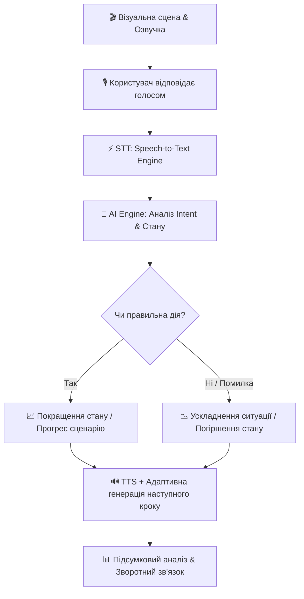

<<<<<<< HEAD
# REACT AI

Навчальний Android-прототип на Kotlin та Jetpack Compose. Інтерфейс, сценарій і локальне розпізнавання фраз працюють без AI API; голосовий ввід використовує системний сервіс Android, озвучення — Android TextToSpeech.

## Запуск

Відкрийте цю папку в Android Studio, дочекайтеся синхронізації Gradle та запустіть конфігурацію `app` на пристрої або емуляторі з Android 8.0 чи новішим. Для голосового вводу потрібен мікрофон і доступ до системного розпізнавання мовлення. Кнопки 103 і 112 відкривають системний екран набору номера з підготовленим номером.

Результати тренувань зберігаються локально на пристрої. Сценарій є навчальною симуляцією і не замінює практичний курс першої допомоги.
=======
gi# 🚑 BeReady — Voice-First AI-Симулятор Кризових Ситуацій

> **«Побачити, що людині зле, — легко. Зрозуміти, що робити далі, — значно складніше.»**

ПТСР-епізод, панічна атака, інсульт чи інфаркт можуть трапитися поруч із нами будь-коли. **BeReady** — це voice-first AI-симулятор з озвученими сценами у стилі графічної новели. Користувач реагує голосом своїми словами, а ШІ в реальному часі розуміє намір (intent), адаптує розвиток подій та дає персональний зворотний зв’язок.

**Це не тест із вибором варіантів. Це інтерактивне тренування реакції в реальній критичній ситуації.**

---

## 🎯 Ключові Можливості

* 🎙️ **Voice-First взаємодія**: Ніяких кнопок чи тестувань — ви говорите так, як діяли б у реальному житті.
* 🎭 **АтмосферMEа графічної новели**: Озвучені інтерактивні сценки із візуалом, що занурює у стан високого напруження.
* 🧠 **NLU & Intent Recognition (Розуміння намірів)**: ШІ оцінює суть вашої дії, а не шукає exact-match фраз.
* 🔀 **Динамічне розгалуження сюжету**: Стан потерпілого та перебіг подій змінюються в реальному часі залежно від швидкості та доцільності ваших дій.
* 📊 **Персоналізований дебрифінг (Feedback)**: Детальний аналіз після симуляції: що було зроблено правильно, де були помилки, як контролювати власну тривогу та стрес.
* 🩺 **Життєві та критичні сценарії**:
  * Реагування на ПТСР-епізоди та гострі психологічні стани
  * Допомога при панічних атаках
  * Розпізнавання та домедична допомога при інсульті й інфаркті
  * Дії у разі екстремальних криз та непритомності

---

## 🔄 Як Це Працює



1. **Занурення**: Ви бачите сцену графічної новели та чуєте аудіосупровід (звуки оточення, голос потерпілого чи свідка).
2. **Реакція**: Ви вголос вимовляєте свої дії (наприклад: *"Я беру людину за руку, звертаюся спокійним голосом і питаю, чи вона мене чує"*).
3. **Обробка в реальному часі**:
   * **Whisper / STT** перетворює аудіо на текст.
   * **AI Engine (LLM)** класифікує intent, оцінює рівень адекватності дій та наявність помилок.
4. **Адаптація**: Система змінює стан потерпілого та генерує наступну дію і голос (TTS).
5. **Дебрифінг**: Після завершення розбираються помилки, алгоритми першої допомоги та надаються рекомендації.

---

## 🛠️ Технологічний Стек

### **Frontend & Visuals**
* **Framework**: [Next.js](https://nextjs.org/) (React, TypeScript)
* **Styling**: Vanilla CSS / Tailwind CSS, Canvas / CSS Micro-animations (стилістика графічної новели)
* **Audio Streaming**: WebRTC / Web Audio API для передачі голосу з мінімальною затримкою

### **Backend & AI Core**
* **API Engine**: [Python 3.11+](https://www.python.org/) & [FastAPI](https://fastapi.tiangolo.com/) (Async processing)
* **Speech-to-Text (STT)**: OpenAI Whisper / AssemblyAI (розпізнавання української мови та інтонацій)
* **Brain / NLU**: OpenAI GPT-4o / Google Gemini 1.5 Flash (оцінка намірів, генерація логіки сценарію)
* **Text-to-Speech (TTS)**: ElevenLabs / Azure Speech (реалістичне озвучення персонажів та фонових подій)
* **Database & Sessions**: PostgreSQL / Redis (збереження сесій тренувань та аналітики)

---

## 🚀 Локальний Запуск та Розгортання

### Передумови (Prerequisites)
* Node.js v18+
* Python 3.11+
* Ключі доступу (API Keys): OpenAI / Gemini API, ElevenLabs API (за потреби)

### 1. Клонування репозиторію
```bash
git clone https://github.com/your-org/beready.git
cd beready
```

### 2. Запуск додатка (Standalone / Без Node.js)
```powershell
cd c:\Users\USER-125-08\Documents\antigravityIDEProjects\BeReady\backend
.\venv\Scripts\activate
py main.py
```

Відкрийте **[http://localhost:8000](http://localhost:8000)** у будь-якому зручному браузері (Edge, Firefox, Safari тощо). Веб-інтерфейс симулятора та API завантажаться одразу з одного сервера!

### 3. Опціонально: Налаштування Frontend (Next.js)
```bash
cd ../frontend
npm install
npm run dev
```
Відкрийте **[http://localhost:3000](http://localhost:3000)**.

---

## 📂 Структура Проєкту

```text
BeReady/
├── frontend/                # Next.js інтерфейс у стилі графічної новели
│   ├── public/              # Графічні асети, арт та звукові ефекти
│   ├── src/
│   │   ├── components/      # Аудіоплеєр, візуалізатор голосу, новела-компоненти
│   │   ├── hooks/           # WebRTC та розпізнавання аудіо
│   │   └── pages/app/       # Екрани симуляції та аналітики
├── backend/                 # Python FastAPI сервер
│   ├── app/
│   │   ├── ai/              # Prompt engineering, NLU logic & Intent evaluators
│   │   ├── voice/           # STT та TTS інтеграції (Whisper, ElevenLabs)
│   │   ├── scenarios/       # База критичних сценаріїв та сюжетних дерев
│   │   └── api/             # REST & WebSockets ендпоінти
├── docs/                    # Документація сценаріїв та алгоритмів домедичної допомоги
└── README.md
```

---

## 🎓 Сценарії Тренувань

| Сценарій | Складність | Ключові навички |
| :--- | :--- | :--- |
| **🚨 ПТСР-епізод у публічному місці** | Середня | Заземлення, правильний тон голосу, безпечні дистанції |
| **💓 Гострий Інфаркт Міокарда** | Висока | Розпізнавання симптомів, виклик 103, горизонтальне положення, спокій |
| **🧠 Інсульт (Тест FAST)** | Середня | Швидка діагностика за алгоритмом FAST, контрольований алгоритм дій |
| **🫨 Панічна Атака поруч** | Базова | Техніки дихання, створення безпечного простору, вербальна підтримка |

---

## 👥 Цільова Аудиторія та Цінність

* **Цивільні громадяни**: Розвиток стресостійкості та подолання паралічу дії ("ступору") в екстрених ситуаціях.
* **Волонтери та медичні інструктори**: Інструмент для закріплення практичних знань після теоретичних курсів першої допомоги.
* **Корпоративне навчання**: Тренінги з безпеки життєдіяльності та ментального здоров'я для організацій.

---

## 🗺️ Roadmap розвитку

- [ ] **Phase 1**: Базовий MVP зі сценаріями панічної атаки та інсульту.
- [ ] **Phase 2**: Розширене озвучення персонажів із емоційною адаптацією (ElevenLabs Conversational AI).
- [ ] **Phase 3**: Інтеграція алгоритмів тактичної медицини (TCCC/STOP THE BLEED).
- [ ] **Phase 4**: Мобільний додаток та офлайн-режим обробки голосу (Local Whisper / Small LLM).

---

## 📜 Ліцензія

Цей проєкт поширюється під ліцензією [MIT](LICENSE).

---

<p align="center">
  Зроблено з турботою про життя та безпеку 💙💛
</p>
>>>>>>> 8047c4cfd82c05f03bcbf72ba1e5c4b7ba0dffa2
